<div align="center">

# AVIVA · Fondos Vivos

**Fondos de pantalla animados hechos con sus nombres, sus fechas y sus frases.
Y en su día especial aparece una sorpresa.**

Para Android, iPhone, Windows, Mac y Linux.

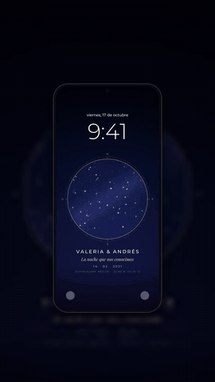

🌐 **[Ver el catálogo](https://developerjgv.github.io/aviva-catalogo/)** · ✨ **[Probar Fondos Vivos+](https://developerjgv.github.io/aviva-catalogo/vivo/)**

</div>

## ¿Qué es?

Es el catálogo de muestra de **AVIVA**: wallpapers animados y personalizados para parejas, aniversarios,
cumpleaños o hasta una pedida de mano. Cada diseño lleva los nombres, la fecha que importa y una frase, y
tiene una **versión de fecha especial**: el 14 de febrero, en su aniversario o en un cumpleaños, el fondo
cambia y les da una sorpresa.

Todo el arte es original. Los nombres y las fechas que salen en el catálogo son de ejemplo.

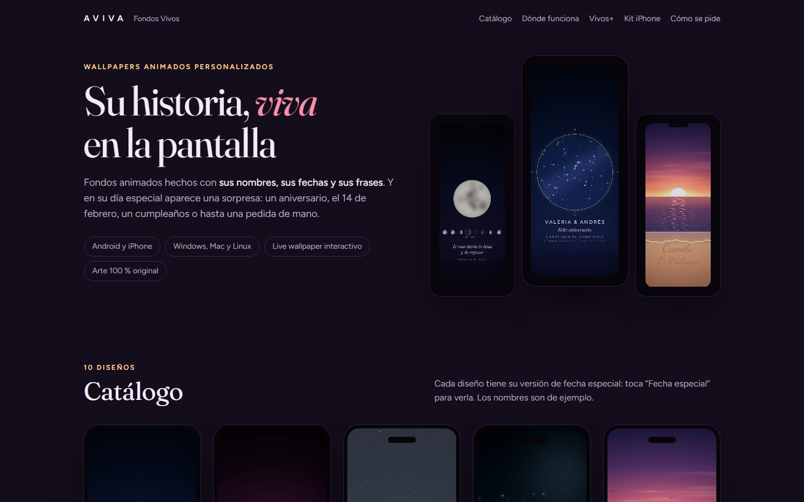

## Catálogo

Diez diseños, cada uno en versión normal y de fecha especial.

<table>
  <tr>
    <td width="20%" align="center">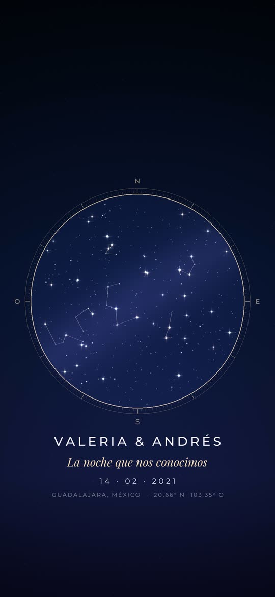<br><b>Mapa estelar</b></td>
    <td width="20%" align="center">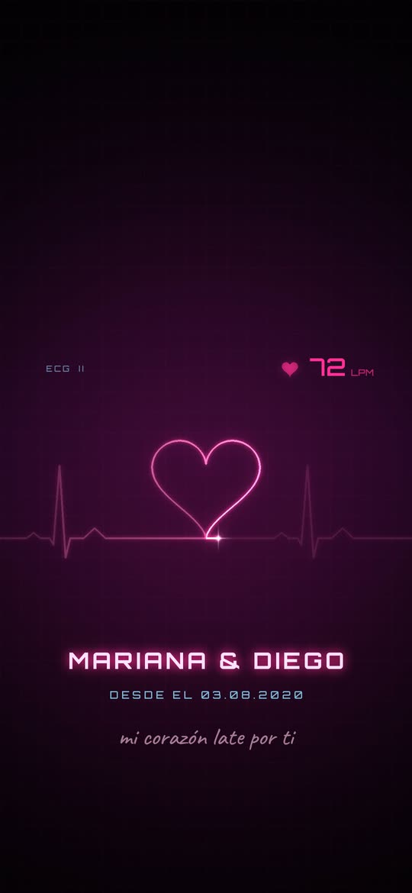<br><b>Latido</b></td>
    <td width="20%" align="center">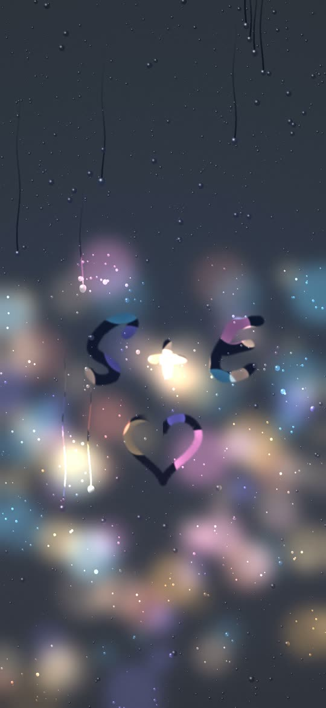<br><b>Lluvia en la ventana</b></td>
    <td width="20%" align="center">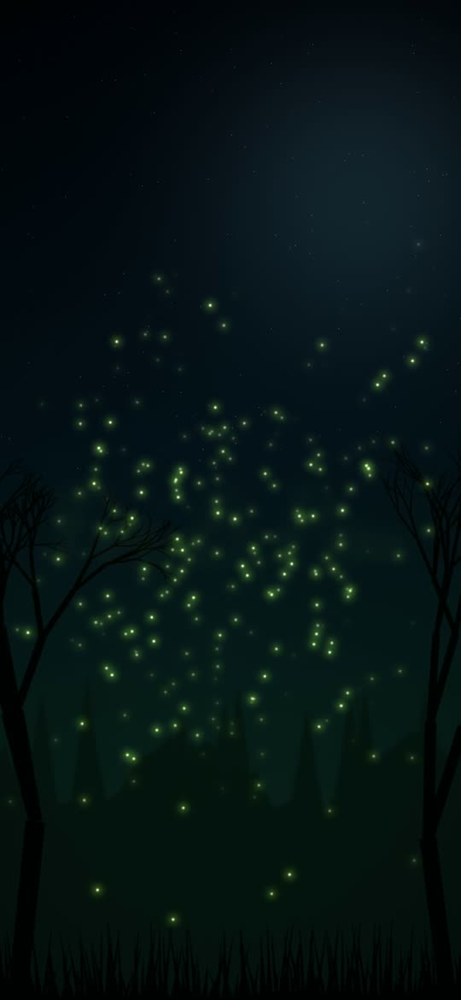<br><b>Luciérnagas</b></td>
    <td width="20%" align="center"><br><b>Atardecer</b></td>
  </tr>
  <tr>
    <td align="center">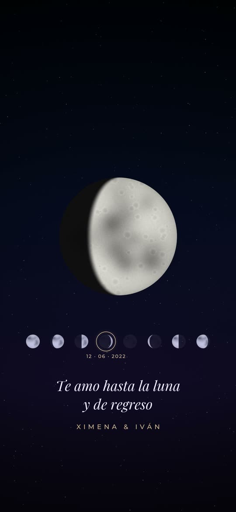<br><b>Luna</b></td>
    <td align="center"><br><b>Sakura</b></td>
    <td align="center">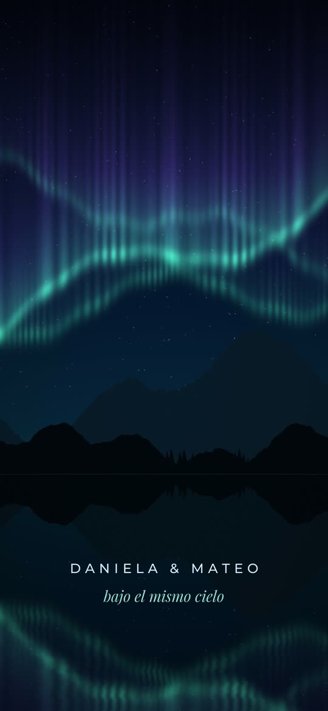<br><b>Aurora boreal</b></td>
    <td align="center">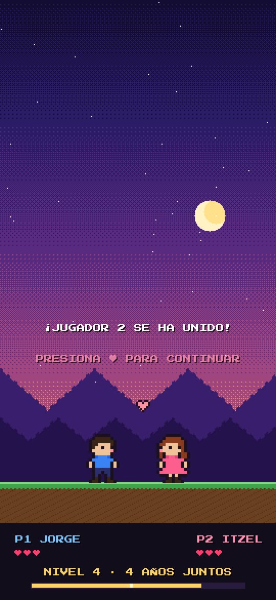<br><b>Jugador 2</b></td>
    <td align="center">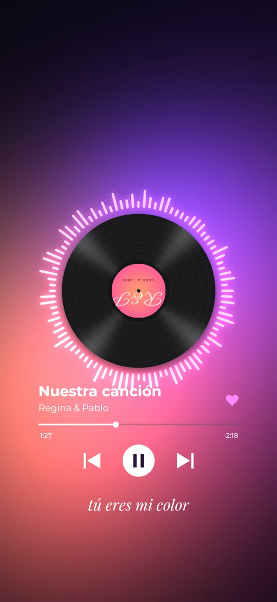<br><b>Nuestra canción</b></td>
  </tr>
</table>

| Diseño | Qué es | Su fecha especial |
| --- | --- | --- |
| **Mapa estelar** | El cielo exacto de la noche en que se conocieron, con su fecha y ciudad. | En su aniversario, las estrellas forman un corazón. |
| **Latido** | Un electrocardiograma neón que dibuja un corazón con sus nombres. | El 14 de febrero, el corazón se enciende. |
| **Lluvia en la ventana** | Sus iniciales escritas en el vaho de un vidrio con lluvia. | ¿A distancia? Cuenta los días para volver a verse. |
| **Luciérnagas** | Cientos de luciérnagas se juntan para escribir sus nombres. | En su aniversario escriben los años juntos. |
| **Atardecer** | Sus nombres escritos en la arena mientras el sol se mete en el mar. | Hasta para pedir matrimonio. |
| **Luna** | La fase de la luna del día que se conocieron. | En su fecha, luna llena con halo rosa. |
| **Sakura** | Pétalos de cerezo cayendo sobre sus nombres. | En su cumpleaños, lluvia de pétalos. |
| **Aurora boreal** | Una aurora boreal reflejada en un lago, solo para ustedes dos. | En Navidad nieva y la aurora se pinta de rojo. |
| **Jugador 2** | Para parejas gamers: ustedes en pixel art, con su nivel en años. | En su aniversario, ¡suben de nivel! |
| **Nuestra canción** | Su canción sonando en un vinilo, con letra y sus iniciales. | El 14 de febrero, la letra cambia. |

## Dónde funciona

| Equipo | Qué ve | Fecha especial | ¿Necesita app? |
| --- | --- | --- | --- |
| **Android** | El video en loop, en la pantalla de bloqueo o de inicio. | Se le manda la versión especial para ese día. | Samsung y varios Xiaomi lo ponen desde Ajustes; los demás, con una app gratis. |
| **iPhone** | Fondo 3D que se mueve al inclinarlo, un mensaje distinto en cada toque y Live Photo al prender la pantalla. | Cambia sola con la app Atajos. | No. |
| **Windows** | El video horizontal en el escritorio, detrás de los íconos. | Con Wallpaper Engine sale sola en su fecha. | Lively Wallpaper (gratis) o Wallpaper Engine. |
| **Mac** | El video horizontal en el escritorio. | Se le manda la versión especial para ese día. | Una app de fondos animados. |
| **Linux** | El video horizontal en el escritorio. | Se le manda la versión especial para ese día. | En KDE un complemento de fondo de video; en GNOME, Hidamari. |

## Fondos Vivos+

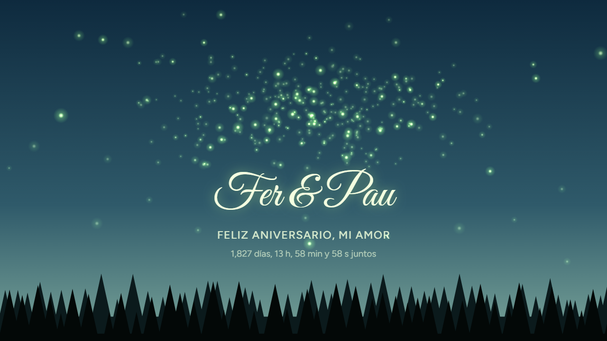

Un video siempre se ve igual. **Fondos Vivos+ no es un video**: es un fondo interactivo que sabe qué día y qué
hora es, lleva la cuenta de cuánto llevan juntos y responde cuando lo tocan.

- **Contador en vivo**: días, horas, minutos y segundos juntos.
- **Cambia solo en sus fechas**: las luciérnagas escriben los años en su aniversario o forman un corazón el 14.
- **El cielo de la hora real**: tarde, atardecer o noche según la hora de la computadora.
- **Responde al tocarlo**: las luciérnagas siguen el mouse o el dedo, y cada toque suelta corazones.

La demo ya funciona como fondo de escritorio de verdad: pega `https://developerjgv.github.io/aviva-catalogo/vivo/`
en **Lively Wallpaper** (Windows), **Plash** (Mac) o un complemento de fondo web en **KDE** (Linux).

## Kit de prueba para iPhone

En la página hay un kit con el diseño **Sakura** para probar todo lo que hace el iPhone: el fondo 3D, los
mensajitos al tocar la pantalla, la Live Photo y el cambio automático en la fecha especial con Atajos. Se abre
desde Safari en el iPhone y cada parte se guarda directo en Fotos.

También se puede [descargar el kit completo en .zip](iphone/kit-sakura-iphone.zip).

## Cómo se pide

1. **Eligen un diseño** del catálogo, o cuentan una idea y se arma.
2. **Mandan su historia**: nombres, la fecha que importa, una frase o su canción, en qué equipo lo van a usar y qué sorpresa quieren.
3. **Reciben su fondo** listo para su equipo, más la versión especial para su fecha.

## Lo que viene

Ideas sobre la misma base, todavía sin construir: fondos conectados entre los dos celulares, notas de amor en
vivo, el cielo real de su ciudad, el clima de su pareja a distancia, cuentas regresivas, un recuerdo cada día,
un fondo al ritmo de su canción y una app AVIVA para Android. Y más allá de las parejas: bodas, XV años, bebés,
mascotas, familia y empresas.

## Estructura del repo

Es una página estática, sin dependencias ni paso de compilación. GitHub Pages la publica desde `main`.

```
index.html        La página del catálogo
vivo/             Fondos Vivos+ (el fondo interactivo)
media/            Videos y portadas de cada diseño, para celular y computadora
iphone/           El kit de prueba Sakura para iPhone
docs/             Capturas de este README
```

Para verla en local basta con abrir `index.html` en el navegador, o servir la carpeta:

```bash
npx serve .
```

---

<div align="center">

<sub>AVIVA es un nombre provisional. Demo con nombres y fechas de ejemplo.</sub>

</div>
